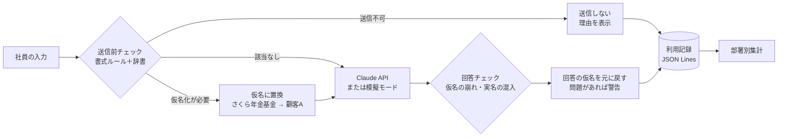

# ai-usage-guardrail

**A pre-send checkpoint between employees and generative AI, designed for asset management firms.**
**It masks client names and contact details with placeholders (restoring them in the AI's reply) and blocks high-risk input such as account numbers, with a clear reason.**
**The AI's reply is also checked in code, and every request is logged by user and department with token counts and estimated cost. It runs fully offline in mock mode with a single command.**

---

## 概要

社員が生成AIを使うとき、顧客名や口座番号、個人情報をそのまま入力してしまうと、社外に情報が出てしまいます。
このプロジェクトは、**AIに送信する直前に入力内容を調べ、AIの回答も確かめる「送信前チェック」の仕組み**です。

- 顧客名・ファンド名・メールアドレスなど、仮名に置き換えれば送信できる情報は `[顧客A]` のような仮名に置き換えてから送り、AIの回答を受け取ったあとで元に戻します。
- 口座番号・マイナンバー・カード番号・未公表情報など、社外に出してはならない情報を含む場合は、送信を止めて理由を表示します。
- AIの回答で仮名が崩れていないか、送っていない実名や番号が書かれていないかをコードで確認し、問題があれば警告します。
- 誰が・どの部署で・いつ・どれだけ使い、いくらかかり、止められたかどうかを記録し、部署別に集計できます。

使用するデータ（顧客名簿・口座番号・テスト入力）はすべて架空のものです。

```bash
npm install
npm run demo        # APIキーなしで、判定・マスクと復元・回答チェック・部署別集計・精度まで一通り表示
npm run demo:step   # 同じデモを、セクションごとに Enter で進める（説明しながら見せる場合）
```

## 解決したい業務課題

資産運用会社では、顧客（年金基金・金融機関など）の名前や取引内容そのものが守秘義務の対象です。生成AIの導入が進む一方で、次のような問題が起きやすくなっています。

| 課題 | 起こりうること |
|---|---|
| うっかり貼り付け | 報告書の下書きを頼むときに、顧客名や口座番号をそのまま貼り付けてしまう |
| ルールの形骸化 | 「機密情報を入力しない」と規程に書いても、どこまでが機密かを現場が毎回判断するのは難しい |
| 利用実態が見えない | どの部署がどれだけ使っているのか、費用や違反の兆候を把握できない |
| 一律禁止の副作用 | 心配だから全面禁止にすると、業務効率化の機会を失い、個人アカウントでの「シャドーAI」を招く |

このプロジェクトでは、**「安全に使える状態をつくる」ことで、禁止ではなく活用を後押しする**ことを狙っています。

## 処理の流れ



仮名と元の値の対応表は処理中のメモリにだけ保持し、AIにも利用記録にも渡しません。

## AIとコードの役割分担

**判断はすべてコードが行い、AIには回答の作成だけを任せています。** 情報を外に出してよいかどうかの判断をAIに任せると、理由を説明できず、結果も毎回同じになるとは限らないためです。

| 担当 | 内容 | 理由 |
|---|---|---|
| コード | 入力の検査、送信可否の判定、仮名への置換 | 判定の根拠をルールIDで説明でき、同じ入力には必ず同じ結果を返す。検査のためにデータを外部へ送らずに済む |
| AI | 仮名のまま、依頼された文章を作る | 文章の作成・要約・構成づくりは、生成AIが最も役に立つ部分 |
| コード | AIの回答のチェック、仮名の復元、利用記録 | AIは指示を守らないことがあるため、回答をそのまま信用せず、コードで確かめる |

AIへの指示（システムプロンプト）では「仮名は同じ表記のまま使う」ように求めていますが、守られたかどうかは次の回答チェックで確認します。

## AIの回答チェック

AIの回答を元に戻す前に、入力と同じルールで回答を検査します。問題があっても回答は止めずに**警告**として表示し、警告の種類だけを利用記録に残します（回答の中身は残しません）。

| チェック | 例 | 起こりうる問題 |
|---|---|---|
| 仮名の崩れ | `【顧客A】`、`[顧客 A]`、括弧が外れた `顧客A` | 元の名前に戻せず、仮名のまま顧客向け文書に使われてしまう |
| 送っていない仮名 | 送ったのは `[顧客A]` だけなのに `[顧客B]` が出てくる | AIが存在しない相手を作り出している |
| 実名・連絡先の混入 | 仮名しか送っていないのに `さくら年金基金` が出てくる | AIが推測で実名を書いている |
| 機密情報の混入 | 回答に口座番号らしき番号が書かれている | AIが番号を作り出しており、そのまま使うと誤りにつながる |
| 回答の途切れ・拒否 | `max_tokens` で打ち切り、または回答を断った | 不完全な回答をそのまま使ってしまう |

`npm run demo` の [4] では、わざと問題を含めた回答を使って、警告が出る様子を確認できます。

## 検知ルール一覧

| ルールID | 対象 | 検知方法 | 処理 | 誤検知を減らす工夫 |
|---|---|---|---|---|
| `account_number` | 口座番号 | 「口座」「口座番号」「Account No.」の近くの7桁、または `123-4567890` 形式 | ブロック | 単独の7桁の数字だけでは反応しない |
| `my_number` | マイナンバー | 12桁（4桁区切りも可） | ブロック | 検査用数字（チェックディジット）が合うものだけを対象にし、文書番号などを除外 |
| `credit_card` | カード番号 | 16桁（区切りも可） | ブロック | Luhn チェックが通るものだけを対象 |
| `confidential_term` | 機密キーワード | 辞書 `confidential_terms.csv`（未公表、インサイダー情報、社外秘 など） | ブロック | 英語の語は単語単位で照合（`Confidential` が `confidentiality` に反応しない） |
| `client_name` | 顧客名 | 辞書 `clients.csv`（正式名称・略称・英語名） | マスク | 表記が違っても同じ顧客は同じ仮名にそろえる |
| `fund_name` | ファンド名 | 辞書 `funds.csv` | マスク | 同上 |
| `email` | メールアドレス | 書式 | マスク | ― |
| `phone` | 電話番号 | 書式（固定電話・携帯電話） | マスク | ハイフンなしは携帯番号の形式のみ対象 |
| `input_too_long` | 長すぎる入力 | 文字数（既定 8,000 文字） | ブロック | 上限は `MAX_INPUT_CHARS` で変更できる |

- 入力は最初に NFKC 正規化するため、全角数字（`２３４５６７８`）も検知できます。
- 1つの入力にマスク対象とブロック対象が混在する場合は、ブロックを優先します。
- 辞書は CSV なので、IT部門でなくても Excel で追加・修正できます。`action` 列を `mask` / `block` に変えるだけで扱いを変更できます。

## 精度（検知漏れ率・誤ブロック率）

`data/test_inputs.json` の20件（すべて架空）で計測しています。`npm run eval` で再計算できます。

| 指標 | 定義 | 結果 |
|---|---|---|
| 検知漏れ率 | 機密情報を含む14件のうち、本来より甘い判定になった割合（ブロックすべきものを通した、マスクすべきものを素通しした） | **14.3%**（2件） |
| 誤ブロック率 | 止める必要のない13件のうち、ブロックしてしまった割合 | **7.7%**（1件） |
| 正解率 | 20件のうち、期待どおりに判定できた割合 | 85.0%（17件） |

うまく扱えなかった3件は、あえてテストデータに含めた「ルールの限界」を示すケースです。

| ID | 入力の内容 | 期待 | 結果 | 原因 |
|---|---|---|---|---|
| C18 | 「サクラ年金」（カタカナ表記の顧客名） | マスク | 通過 | 辞書に登録していない表記ゆれは検知できない |
| C19 | 「口座は一二三四五六七」（漢数字） | ブロック | 通過 | 漢数字は書式ルールに一致しない |
| C20 | 「インサイダー情報とは何か、一般的な定義を教えて」 | 通過 | ブロック | キーワード一致では、一般的な質問と実際の未公表情報を区別できない |

この3件は自動テストでも「既知の限界」として現在の挙動を固定しています。ルールを改善してこれらが正しく判定されるようになるとテストが失敗するため、README の数値と実装がずれることはありません。

## ルール検知の限界

ルール（正規表現・辞書）による検知は、説明しやすく、動作が予測でき、外部にデータを出さずに済むという利点があります。一方で、次のような限界があります。

- **辞書にないものは分からない**：新規顧客の登録漏れ、略称・愛称・カタカナ表記・誤字には反応できません。
- **文脈を理解しない**：「インサイダー情報とは」という一般的な質問と、実際の未公表情報の共有を区別できません。
- **書き方を変えるとすり抜ける**：漢数字、数字の間に文字を挟む、画像やファイルで渡すといった方法には対応していません。
- **組み合わせによる特定**：「先月解約した大口の企業年金」のように、名前を出さなくても相手が分かってしまう情報は検知できません。
- **回答の正しさは確かめられない**：回答チェックで分かるのは仮名の崩れや情報の混入までで、内容が事実として正しいかどうかは判断できません。

そのため、この仕組みだけで情報漏えいを防げるとは考えていません。**社内規程（[生成AI利用ルール](docs/ai-usage-rules.md)）と、利用者本人や上長による確認を組み合わせることが前提**です。

## セキュリティとコストの考え方

### 情報を外に出さないために

| 対策 | 実装 |
|---|---|
| 送信不可の情報はAIに送らない | ブロックした入力では、AIの呼び出しそのものを行わない（`src/guardrail.ts`） |
| 仮名と元の値の対応表は外に出さない | 処理中のメモリにだけ保持し、AIにも利用記録にも渡さない（`src/masker.ts`） |
| 記録が新たな漏えい源にならないようにする | 利用記録には検知した値も入力文も残さず、ルールIDと警告の種類だけを残す（`src/usage.ts`） |
| 画面表示でも値を伏せる | 検知した値は `12***67` のように一部だけ表示する（`src/preview.ts`） |
| APIキーを公開しない | `.env` に置き、`.gitignore` で除外する |
| 簡易画面を社内ネットワークに公開しない | `127.0.0.1` でだけ待ち受け、受け付ける入力の大きさにも上限を設ける（`src/web/server.ts`） |

### トークンと費用を抑えるために

| 対策 | 実装 |
|---|---|
| 止めた入力には費用をかけない | ブロックした入力はAIを呼ばないため、費用は0円（デモでは20件中7件） |
| 大量の貼り付けを防ぐ | 8,000文字を超える入力は送信せずに止める（`MAX_INPUT_CHARS`） |
| 回答の長さに上限を設ける | `MAX_TOKENS`（既定 2,048） |
| AIが考える量を抑える | 文書作成の補助には深い推論が不要なため、`effort` を `low` にしている（`EFFORT`） |
| 費用を見える化する | 1件ごとのトークン数と推定費用を記録し、部署別に集計する。Claude API 使用時は API が返す実測値を使う |
| 料金を設定で変えられるようにする | 既定値は `claude-sonnet-5-5` の料金（100万トークンあたり入力 $2 / 出力 $10）。モデルを変えたら環境変数で合わせる |

AIの呼び出しに失敗した場合（APIキーの誤り・接続できない・利用上限など）は、処理を止めずに理由を表示し、「エラー」として記録します。また、モデルが安全上の理由で回答を断った場合は、API側で自動的に別のモデルに切り替える設定（サーバー側フォールバック）を有効にしています。

## 実際の企業での多層防御と、本プロジェクトの担当範囲

| 層 | 対策 | 内容 | 本プロジェクト |
|---|---|---|---|
| 1 | 契約したAIだけを使う | 入力データを学習に使わない契約の法人向けサービスに限定し、個人アカウントや無料版の利用を禁止 | 対象外（調達・契約） |
| 2 | 権限管理 | SSO で利用者を特定し、部署・役職ごとに使えるAIや機能を制御 | 対象外（ユーザーIDと部署を受け取る前提） |
| 3 | **送信前チェック** | 機密情報の検知、仮名への置換、送信不可の入力の遮断 | **✅ 担当** |
| 4 | 人による確認 | 判断に迷う場合はコンプライアンス部門に相談。AIの回答を顧客向け文書に使う前に担当者と上長が確認 | ブロック理由の表示と回答チェックの警告で、確認すべき箇所を示す |
| 5 | 利用記録と監査 | 誰が・いつ・どれだけ使ったか、ブロックや警告がどこで多いかを定期的に確認 | **✅ 記録と部署別集計を担当** |

規程の例として、日英対照の [生成AI利用ルール（サンプル）](docs/ai-usage-rules.md) を用意しています。

## 使い方

### 必要なもの

- Node.js 20.12 以降（22 推奨）
- Claude API キー（任意。なければ自動で模擬モードになります）

### セットアップ

```bash
git clone https://github.com/Eiennokoh/ai-usage-guardrail.git
cd ai-usage-guardrail
npm install
```

Claude API を使う場合は `.env.example` をコピーして `.env` を作り、APIキーを設定します。`.env` は `.gitignore` で除外しているため、GitHub には上がりません。

```bash
cp .env.example .env
# .env の ANTHROPIC_API_KEY を設定（モデルを変える場合は ANTHROPIC_MODEL と料金も変更）
```

### コマンド一覧

| コマンド | 内容 |
|---|---|
| `npm run demo` | デモ（数秒で完了）。常に模擬モードで、判定 → マスクと復元 → ブロック理由 → 回答チェック → 部署別集計 → 精度 の順に表示 |
| `npm run demo:step` | 同じデモを、セクションごとに Enter で進める |
| `npm run demo:live` | 同じデモを Claude API で実行（APIキーが必要。ブロックした入力は送信しないため、API呼び出しは13回） |
| `npm run ask -- --user tanaka --dept 運用部 "依頼文"` | 1件だけ送信。`--mock` を付けると APIキーがあっても模擬モード |
| `npm run report` | `logs/usage.jsonl` を部署別に集計（`-- --log logs/demo-usage.jsonl` でデモの記録も可） |
| `npm run web` | 簡易画面を起動（http://127.0.0.1:3000）。テスト入力をボタンで呼び出して試せます |
| `npm run eval` | テスト入力で検知漏れ率・誤ブロック率を計算 |
| `npm test` | 自動テスト（51件） |
| `npm run typecheck` | 型チェック |

### 環境変数

| 変数 | 既定値 | 説明 |
|---|---|---|
| `ANTHROPIC_API_KEY` | なし | 設定すると Claude API を使用。未設定なら模擬モード |
| `ANTHROPIC_MODEL` | `claude-sonnet-5-5` | 使用するモデル名 |
| `GUARDRAIL_MODE` | `auto` | `auto` / `live` / `mock`。`mock` にすると APIキーがあっても送信しない |
| `MAX_TOKENS` | `2048` | 回答の最大トークン数 |
| `EFFORT` | `low` | AIが考える量（`low` / `medium` / `high` / `xhigh` / `max`）。空にすると API に送らない |
| `MAX_INPUT_CHARS` | `8000` | 1回の入力の上限文字数。超えた入力は送信せずに止める |
| `PRICE_INPUT_USD_PER_MTOK` | `2` | 入力100万トークンあたりの料金（USD）。モデルを変えたら公式の料金表を確認して設定 |
| `PRICE_OUTPUT_USD_PER_MTOK` | `10` | 出力100万トークンあたりの料金（USD） |
| `USAGE_LOG_PATH` | `logs/usage.jsonl` | 利用記録の出力先 |
| `DICTIONARY_DIR` | `data/dictionaries` | 辞書CSVの置き場所 |

模擬モードのトークン数は文字数からの概算です（英数字は約4文字で1トークン、日本語は約1文字1トークン）。Claude API 使用時は API が返す実測値を記録します。

### 他のプロジェクトから使う

AIを呼び出す前に、このチェックを通すだけで使えます（`examples/integrate.ts` に動く例があります）。

```ts
import { createGuardrail } from './src/index';

const guardrail = createGuardrail(); // 環境変数から Claude API / 模擬モードを自動で選択

// 1) 内蔵の Claude クライアントで送信
const res = await guardrail.run({ user: 'tanaka', department: '運用部', prompt: '...' });
if (res.status === 'blocked') console.log(res.blockReasons);
else if (res.status === 'error') console.log(res.error);
else {
  if (res.outputCheck?.status === 'warning') console.log(res.outputCheck.issues);
  console.log(res.restoredResponse);
}

// 2) すでにあるAI呼び出し関数を包む（社内の別システムに組み込む場合）
const safeAsk = guardrail.protect((maskedPrompt) => myExistingAiCall(maskedPrompt));
const res2 = await safeAsk({ user: 'sato', department: '営業企画部', prompt: '...' });
```

`protect()` で包んだ関数には、マスク済みの文しか渡りません。ブロック対象なら関数そのものが呼ばれません。返ってきた回答には、内蔵クライアントと同じ回答チェックを行います。

## 利用記録の形式

`logs/usage.jsonl` に1行1件の JSON で追記します。**検知した値（顧客名・口座番号など）や入力文は記録せず、どのルールに該当したか、回答チェックでどの警告が出たかだけを残します。** 記録自体が新たな漏えい源にならないようにするためです。

```json
{"timestamp":"2026-11-05T06:12:03.120Z","user":"sato","department":"営業企画部","mode":"live","model":"claude-sonnet-5-5","status":"sent","decision":"mask","ruleIds":["client_name","email"],"outputIssues":[],"inputTokens":142,"outputTokens":318,"tokensEstimated":false,"estimatedCostUsd":0.003464}
```

`status` は `sent`（送信した）/ `blocked`（送信前に止めた）/ `error`（AI側のエラー）のいずれかです。

JSON Lines にしたのは、追記が速く、ログ基盤やBIツールにそのまま取り込めるためです（Excel でも Power Query で読み込めます）。

## ディレクトリ構成

```
ai-usage-guardrail/
├── src/
│   ├── index.ts          # 公開API（createGuardrail）
│   ├── guardrail.ts      # 本体：検査 → ブロック／マスク → 送信 → 回答チェック → 復元 → 記録
│   ├── inspector.ts      # 書式ルールと辞書による検知
│   ├── rules.ts          # 検知ルール定義（チェックディジット検証を含む）
│   ├── masker.ts         # 仮名への置換と復元
│   ├── outputCheck.ts    # AIの回答チェック（仮名の崩れ・実名や機密情報の混入・途切れ）
│   ├── preview.ts        # 表示用に値の一部を伏せる
│   ├── dictionary.ts     # 辞書CSVの読み込み
│   ├── usage.ts          # 利用記録・費用計算・部署別集計
│   ├── evaluation.ts     # 検知漏れ率・誤ブロック率の計算
│   ├── config.ts         # 環境変数の読み込み
│   ├── llm/              # Claude API クライアントと模擬クライアント
│   ├── cli/              # demo / ask / report / eval
│   └── web/              # 簡易画面
├── data/
│   ├── dictionaries/     # 顧客名・ファンド名・機密キーワード（すべて架空）
│   └── test_inputs.json  # テスト入力20件（すべて架空）
├── docs/ai-usage-rules.md  # 生成AI利用ルール（日英対照のサンプル）
├── examples/integrate.ts   # 他プロジェクトからの利用例
└── tests/                  # 自動テスト
```

## 設計で意識したこと

- **判断はコード、文章づくりはAI**：送信してよいかの判断はルールで行い、結果を説明できるようにしました。AIには、得意な文章の作成だけを任せています。
- **AIの回答も信用しきらない**：仮名を守るようAIに指示するだけでなく、守られたかどうかをコードで確かめます。
- **APIキーがなくても最後まで動く**：模擬モードでも、マスクした仮名を含む回答を返すので、置換から復元までの流れを確認できます。デモやレビューの場で、ネットワークやキーの有無に左右されずに見せられます。
- **AIの呼び出し口を差し替えられる**：`LlmClient` の形に合わせれば、Claude 以外のモデルや社内の基盤にも同じチェックを使えます。
- **誤検知への配慮**：12桁や16桁の数字をすべて止めると、文書番号まで止まってしまい現場が使わなくなります。チェックディジットで絞り込み、「止めるべきものだけを止める」ことを重視しました。
- **精度を数字で示す**：うまくいかないケースもテストデータに含め、検知漏れ率・誤ブロック率として公開しています。

## 今後の改善案

- 辞書の表記ゆれ対策（カタカナ・ひらがなの統一、類似文字列での照合）
- 文脈判断が必要なケースに限り、社内に閉じた小型モデルで二次判定
- ブロック時に「この表現なら送れます」という書き換え案を提示
- 利用記録のダッシュボード化と、ブロックや回答の警告が急増した部署へのアラート

## ライセンス

MIT
